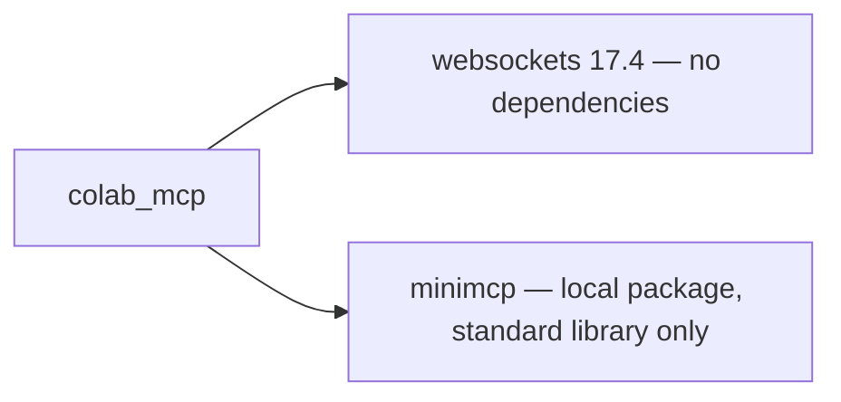
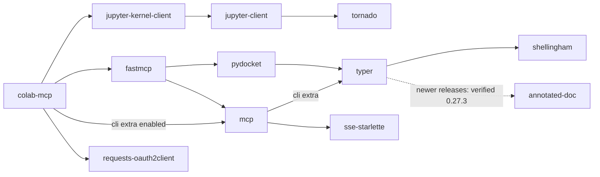

# Dependency graph

Current runtime:



The graphs below preserve the original dependency audit and the SDK-only alternative.

Audit snapshot: 2026-11-03, Windows / Python 3.15. Arrows mean **depends on**. Package names normalize underscores to hyphens.

The original checked-in `uv.lock` contains **107 reachable runtime packages** on this platform, including requested extras; development and build dependencies are excluded. `pip install .` does not read that lockfile, so its versions can differ. The cancelled installation has no saved resolver report; these graphs are not a reconstruction of everything it downloaded.

## The packages you asked about

Solid edges below come from the original lockfile. The dotted edge is from newer Typer metadata.



| Package | Why it enters the original dependency tree | Possible SDK-only version (not implemented) |
| --- | --- | --- |
| `tornado` | `jupyter-kernel-client → jupyter-client → tornado`. The project never imports the kernel client. | Remove the unused root dependency. |
| `typer` | Both `mcp[cli] → typer` and `fastmcp → pydocket → typer`. This project uses stdlib `argparse` for its own CLI. | Remove the MCP CLI extra and replace FastMCP. |
| `shellingham` | `typer → shellingham`. | Disappears with Typer. |
| `annotated_doc` | Newer `typer → annotated-doc`; absent from locked Typer 0.21.1. | Absent from the SDK-only resolution. |
| `sse_starlette` | Mandatory `mcp → sse-starlette`, for the SDK’s HTTP/SSE transport support. | Remains: not an optional SDK extra, even with stdio. |
| `requests_oauth2client` | Declared directly by this project; no import or usage in `src/`. | Remove the unused root dependency. |

The `annotated-doc` edge is verified in [Typer 0.27.3 package metadata](https://pypi.org/pypi/typer/0.27.3/json). Without the cancelled command’s full output, its selected version and any other routes to that package are unknown.

## Complete original runtime graph

<details>
<summary>Expand the 107-package Windows graph</summary>

```mermaid
flowchart LR
    annotated_types["annotated-types 0.7.0"]
    anyio["anyio 4.12.1"]
    attrs["attrs 25.4.0"]
    authlib["authlib 1.6.9"]
    beartype["beartype 0.22.9"]
    binapy["binapy 0.8.0"]
    cachetools["cachetools 7.0.0"]
    certifi["certifi 2026.1.4"]
    cffi["cffi 2.0.0"]
    charset_normalizer["charset-normalizer 3.4.4"]
    click["click 8.3.1"]
    cloudpickle["cloudpickle 3.1.2"]
    colab_mcp["colab-mcp 1.0.1"]
    colorama["colorama 0.4.6"]
    cronsim["cronsim 2.7"]
    cryptography["cryptography 46.0.5"]
    cyclopts["cyclopts 4.5.1"]
    diskcache["diskcache 5.6.3"]
    dnspython["dnspython 2.8.0"]
    docstring_parser["docstring-parser 0.17.0"]
    docutils["docutils 0.22.4"]
    email_validator["email-validator 2.3.0"]
    exceptiongroup["exceptiongroup 1.3.1"]
    fakeredis["fakeredis 2.33.0"]
    fastmcp["fastmcp 2.14.5"]
    furl["furl 2.1.4"]
    google_auth["google-auth 2.48.0"]
    google_auth_oauthlib["google-auth-oauthlib 1.2.4"]
    h11["h11 0.16.0"]
    httpcore["httpcore 1.0.9"]
    httpx["httpx 0.28.1"]
    httpx_sse["httpx-sse 0.4.3"]
    idna["idna 3.11"]
    importlib_metadata["importlib-metadata 8.7.1"]
    jaraco_classes["jaraco-classes 3.4.0"]
    jaraco_context["jaraco-context 6.1.0"]
    jaraco_functools["jaraco-functools 4.4.0"]
    jsonref["jsonref 1.1.0"]
    jsonschema["jsonschema 4.26.0"]
    jsonschema_path["jsonschema-path 0.3.4"]
    jsonschema_specifications["jsonschema-specifications 2025.9.1"]
    jupyter_client["jupyter-client 8.8.0"]
    jupyter_core["jupyter-core 5.9.1"]
    jupyter_kernel_client["jupyter-kernel-client 0.9.0"]
    jupyter_mimetypes["jupyter-mimetypes 0.2.0"]
    jwskate["jwskate 0.12.2"]
    keyring["keyring 25.7.0"]
    lupa["lupa 2.6"]
    markdown_it_py["markdown-it-py 4.0.0"]
    mcp["mcp 1.26.0"]
    mdurl["mdurl 0.1.2"]
    more_itertools["more-itertools 10.8.0"]
    oauthlib["oauthlib 3.3.1"]
    openapi_pydantic["openapi-pydantic 0.5.1"]
    opentelemetry_api["opentelemetry-api 1.39.1"]
    orderedmultidict["orderedmultidict 1.0.2"]
    packaging["packaging 26.0"]
    pathable["pathable 0.4.4"]
    pathvalidate["pathvalidate 3.3.1"]
    platformdirs["platformdirs 4.5.1"]
    prometheus_client["prometheus-client 0.24.1"]
    py_key_value_aio["py-key-value-aio 0.3.0"]
    py_key_value_shared["py-key-value-shared 0.3.0"]
    pyarrow["pyarrow 23.0.0"]
    pyasn1["pyasn1 0.6.3"]
    pyasn1_modules["pyasn1-modules 0.4.2"]
    pycparser["pycparser 3.0"]
    pydantic["pydantic 2.12.5"]
    pydantic_core["pydantic-core 2.41.5"]
    pydantic_settings["pydantic-settings 2.12.0"]
    pydocket["pydocket 0.18.2"]
    pygments["pygments 2.19.2"]
    pyjwt["pyjwt 2.12.0"]
    pyperclip["pyperclip 1.11.0"]
    python_dateutil["python-dateutil 2.9.0.post0"]
    python_dotenv["python-dotenv 1.2.1"]
    python_json_logger["python-json-logger 4.0.0"]
    python_multipart["python-multipart 0.0.22"]
    pywin32["pywin32 311"]
    pywin32_ctypes["pywin32-ctypes 0.2.3"]
    pyyaml["pyyaml 6.0.3"]
    pyzmq["pyzmq 27.1.0"]
    redis["redis 7.1.0"]
    referencing["referencing 0.36.2"]
    requests["requests 2.32.5"]
    requests_oauth2client["requests-oauth2client 1.8.0"]
    requests_oauthlib["requests-oauthlib 2.0.0"]
    rich["rich 14.3.2"]
    rich_rst["rich-rst 1.3.2"]
    rpds_py["rpds-py 0.30.0"]
    rsa["rsa 4.9.1"]
    shellingham["shellingham 1.5.4"]
    six["six 1.17.0"]
    sortedcontainers["sortedcontainers 2.4.0"]
    sse_starlette["sse-starlette 3.2.0"]
    starlette["starlette 0.52.1"]
    tornado["tornado 6.5.5"]
    traitlets["traitlets 5.14.3"]
    typer["typer 0.21.1"]
    typing_extensions["typing-extensions 4.15.0"]
    typing_inspection["typing-inspection 0.4.2"]
    tzdata["tzdata 2025.3"]
    uncalled_for["uncalled-for 0.2.0"]
    urllib3["urllib3 2.6.3"]
    uvicorn["uvicorn 0.40.0"]
    websocket_client["websocket-client 1.9.0"]
    websockets["websockets 16.0"]
    zipp["zipp 3.23.0"]
    anyio --> idna
    authlib --> cryptography
    binapy --> typing_extensions
    cffi --> pycparser
    click --> colorama
    colab_mcp --> anyio
    colab_mcp --> fastmcp
    colab_mcp --> google_auth_oauthlib
    colab_mcp --> jupyter_kernel_client
    colab_mcp --> mcp
    colab_mcp --> pydantic
    colab_mcp --> requests
    colab_mcp --> requests_oauth2client
    colab_mcp --> websockets
    cryptography --> cffi
    cyclopts --> attrs
    cyclopts --> docstring_parser
    cyclopts --> rich
    cyclopts --> rich_rst
    email_validator --> dnspython
    email_validator --> idna
    fakeredis -->|"lua extra"| lupa
    fakeredis --> redis
    fakeredis --> sortedcontainers
    fastmcp --> authlib
    fastmcp --> cyclopts
    fastmcp --> exceptiongroup
    fastmcp --> httpx
    fastmcp --> jsonref
    fastmcp --> jsonschema_path
    fastmcp --> mcp
    fastmcp --> openapi_pydantic
    fastmcp --> packaging
    fastmcp --> platformdirs
    fastmcp --> py_key_value_aio
    fastmcp --> pydantic
    fastmcp --> pydocket
    fastmcp --> pyperclip
    fastmcp --> python_dotenv
    fastmcp --> rich
    fastmcp --> uvicorn
    fastmcp --> websockets
    furl --> orderedmultidict
    furl --> six
    google_auth --> cryptography
    google_auth --> pyasn1_modules
    google_auth --> rsa
    google_auth_oauthlib --> google_auth
    google_auth_oauthlib --> requests_oauthlib
    httpcore --> certifi
    httpcore --> h11
    httpx --> anyio
    httpx --> certifi
    httpx --> httpcore
    httpx --> idna
    importlib_metadata --> zipp
    jaraco_classes --> more_itertools
    jaraco_functools --> more_itertools
    jsonschema --> attrs
    jsonschema --> jsonschema_specifications
    jsonschema --> referencing
    jsonschema --> rpds_py
    jsonschema_path --> pathable
    jsonschema_path --> pyyaml
    jsonschema_path --> referencing
    jsonschema_path --> requests
    jsonschema_specifications --> referencing
    jupyter_client --> jupyter_core
    jupyter_client --> python_dateutil
    jupyter_client --> pyzmq
    jupyter_client --> tornado
    jupyter_client --> traitlets
    jupyter_core --> platformdirs
    jupyter_core --> traitlets
    jupyter_kernel_client --> jupyter_client
    jupyter_kernel_client --> jupyter_core
    jupyter_kernel_client --> jupyter_mimetypes
    jupyter_kernel_client --> requests
    jupyter_kernel_client --> traitlets
    jupyter_kernel_client --> typing_extensions
    jupyter_kernel_client --> websocket_client
    jupyter_mimetypes --> pyarrow
    jupyter_mimetypes --> typing_extensions
    jwskate --> binapy
    jwskate --> cryptography
    jwskate --> typing_extensions
    keyring --> jaraco_classes
    keyring --> jaraco_context
    keyring --> jaraco_functools
    keyring --> pywin32_ctypes
    markdown_it_py --> mdurl
    mcp --> anyio
    mcp --> httpx
    mcp --> httpx_sse
    mcp --> jsonschema
    mcp --> pydantic
    mcp --> pydantic_settings
    mcp --> pyjwt
    mcp -->|"cli extra"| python_dotenv
    mcp --> python_multipart
    mcp --> pywin32
    mcp --> sse_starlette
    mcp --> starlette
    mcp -->|"cli extra"| typer
    mcp --> typing_extensions
    mcp --> typing_inspection
    mcp --> uvicorn
    openapi_pydantic --> pydantic
    opentelemetry_api --> importlib_metadata
    opentelemetry_api --> typing_extensions
    orderedmultidict --> six
    py_key_value_aio --> beartype
    py_key_value_aio -->|"memory extra"| cachetools
    py_key_value_aio -->|"disk extra"| diskcache
    py_key_value_aio -->|"keyring extra"| keyring
    py_key_value_aio -->|"disk extra"| pathvalidate
    py_key_value_aio --> py_key_value_shared
    py_key_value_aio -->|"redis extra"| redis
    py_key_value_shared --> beartype
    py_key_value_shared --> typing_extensions
    pyasn1_modules --> pyasn1
    pydantic --> annotated_types
    pydantic -->|"email extra"| email_validator
    pydantic --> pydantic_core
    pydantic --> typing_extensions
    pydantic --> typing_inspection
    pydantic_core --> typing_extensions
    pydantic_settings --> pydantic
    pydantic_settings --> python_dotenv
    pydantic_settings --> typing_inspection
    pydocket --> cloudpickle
    pydocket --> cronsim
    pydocket --> fakeredis
    pydocket --> opentelemetry_api
    pydocket --> prometheus_client
    pydocket --> py_key_value_aio
    pydocket --> python_json_logger
    pydocket --> redis
    pydocket --> rich
    pydocket --> typer
    pydocket --> typing_extensions
    pydocket --> tzdata
    pydocket --> uncalled_for
    pyjwt -->|"crypto extra"| cryptography
    python_dateutil --> six
    referencing --> attrs
    referencing --> rpds_py
    requests --> certifi
    requests --> charset_normalizer
    requests --> idna
    requests --> urllib3
    requests_oauth2client --> attrs
    requests_oauth2client --> binapy
    requests_oauth2client --> furl
    requests_oauth2client --> jwskate
    requests_oauth2client --> requests
    requests_oauthlib --> oauthlib
    requests_oauthlib --> requests
    rich --> markdown_it_py
    rich --> pygments
    rich_rst --> docutils
    rich_rst --> rich
    rsa --> pyasn1
    sse_starlette --> anyio
    sse_starlette --> starlette
    starlette --> anyio
    typer --> click
    typer --> rich
    typer --> shellingham
    typer --> typing_extensions
    typing_inspection --> typing_extensions
    uvicorn --> click
    uvicorn --> h11
```

</details>

## SDK-only candidate

A wheel-only pip dry run of `mcp>=1.26,<2` and `websockets==17.4` resolved **31 runtime packages**. It selected MCP 1.30.0. This is metadata resolution, not a completed runtime test or a security audit of these packages.

```mermaid
flowchart LR
    project["colab-mcp"] --> mcp
    project --> websockets
    project --> anyio
    project --> pydantic
    annotated_types["annotated-types 0.8.0"]
    anyio["anyio 4.16.0"]
    attrs["attrs 26.1.0"]
    certifi["certifi 2026.10.23"]
    cffi["cffi 2.1.1"]
    click["click 8.5.0"]
    cryptography["cryptography 50.0.2"]
    h11["h11 0.16.0"]
    httpcore["httpcore 1.0.9"]
    httpx["httpx 0.28.1"]
    httpx_sse["httpx-sse 0.4.3"]
    idna["idna 3.20"]
    jsonschema["jsonschema 4.26.0"]
    jsonschema_specifications["jsonschema-specifications 2025.9.1"]
    mcp["mcp 1.30.0"]
    pycparser["pycparser 3.12"]
    pydantic["pydantic 2.14.2"]
    pydantic_core["pydantic-core 2.50.2"]
    pydantic_settings["pydantic-settings 2.16.2"]
    pyjwt["pyjwt 2.15.1"]
    python_dotenv["python-dotenv 1.2.4"]
    python_multipart["python-multipart 0.0.33"]
    pywin32["pywin32 312"]
    referencing["referencing 0.37.0"]
    rpds_py["rpds-py 2026.9.1"]
    sse_starlette["sse-starlette 3.6.0"]
    starlette["starlette 1.10.0"]
    typing_extensions["typing-extensions 4.16.0"]
    typing_inspection["typing-inspection 0.4.4"]
    uvicorn["uvicorn 0.54.0"]
    websockets["websockets 17.4"]
    anyio --> idna
    cffi --> pycparser
    cryptography --> cffi
    httpcore --> certifi
    httpcore --> h11
    httpx --> anyio
    httpx --> certifi
    httpx --> httpcore
    httpx --> idna
    jsonschema --> attrs
    jsonschema --> jsonschema_specifications
    jsonschema --> referencing
    jsonschema --> rpds_py
    jsonschema_specifications --> referencing
    mcp --> anyio
    mcp --> httpx
    mcp --> httpx_sse
    mcp --> jsonschema
    mcp --> pydantic
    mcp --> pydantic_settings
    mcp --> pyjwt
    mcp --> python_multipart
    mcp --> pywin32
    mcp --> sse_starlette
    mcp --> starlette
    mcp --> typing_extensions
    mcp --> typing_inspection
    mcp --> uvicorn
    pydantic --> annotated_types
    pydantic --> pydantic_core
    pydantic --> typing_extensions
    pydantic --> typing_inspection
    pydantic_core --> typing_extensions
    pydantic_settings --> pydantic
    pydantic_settings --> python_dotenv
    pydantic_settings --> typing_extensions
    pydantic_settings --> typing_inspection
    pyjwt --> cryptography
    referencing --> attrs
    referencing --> rpds_py
    sse_starlette --> anyio
    sse_starlette --> starlette
    starlette --> anyio
    typing_inspection --> typing_extensions
    uvicorn --> click
    uvicorn --> h11
```

## What cancellation tells us

No final packages installed does **not** prove no package code ran. Pip can install temporary build dependencies and run backend hooks while preparing metadata, before installation. If the original command reached dependency resolution for this local project, its Hatchling backend had already run. There is no saved output to establish which dependency source builds, if any, also ran. See [pip’s build process](https://pip.pypa.io/en/stable/reference/build-system/).

The audit dry run used `--only-binary=:all:` with named registry packages, so it did not build source packages. For controlled installation, combine reviewed version/hash pins with wheel-only downloads; hashes establish artifact identity, not whether the code is trustworthy. See [pip secure installs](https://pip.pypa.io/en/stable/topics/secure-installs/).
